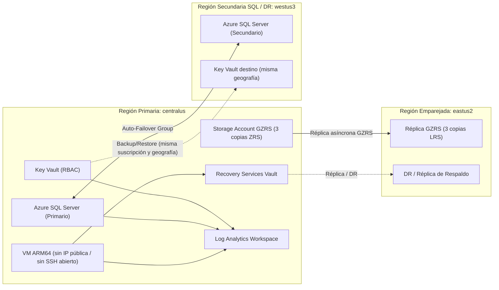

# Laboratorio 01: Continuidad Empresarial y Recuperación ante Desastres (BCDR)

> **Estado del laboratorio:** En progreso / En revisión (correcciones técnicas de auditoría en curso).  
> **Enfoque AZ-305:** Continuidad del negocio, almacenamiento de datos y monitoreo/observabilidad.

## Arquitectura de Referencia

En `centralus`, el almacenamiento con **GZRS** (`Standard_GZRS`) mantiene **3 copias síncronas entre zonas de disponibilidad (ZRS)** en la región primaria y **3 copias asíncronas en una única ubicación (LRS)** en la región secundaria emparejada (`eastus2`). Para **Azure SQL Database**, un *Auto-Failover Group* replica hacia una región secundaria (`westus3` en este laboratorio) con endpoints de lectura/escritura y solo lectura. Para **Azure Key Vault**, las copias cifradas de secretos, claves y certificados se restauran dentro de la **misma suscripción y geografía**.

## Decisiones de Arquitectura (ADR)

| Decisión | Elección en el Lab | Alternativa evaluada | Motivo técnico (AZ-305) |
| :--- | :--- | :--- | :--- |
| **Redundancia de Storage** | `Standard_GZRS` (`centralus` ↔ `eastus2`) | `LRS` / `ZRS` / `RA-GZRS` | Combina disponibilidad zonal en primaria (3 copias ZRS) con DR regional (3 copias LRS); `RA-GZRS` añade lectura secundaria si se requiere, con mayor costo. |
| **Failover de SQL** | *Auto-Failover Group* (`Manual` para pruebas controladas; `Automatic` con *grace period* para fallos amplios) | *Zone Redundancy* en una sola región | *Zone Redundancy* protege frente a fallos zonales (y no aplica a `S0`), mientras que el *Failover Group* protege ante caídas regionales. |
| **Respaldo y DR de VM** | *Azure Backup* + *Log Analytics* (`Azure Monitor Agent` / *Diagnostic Settings*) | *Azure Site Recovery* / IP pública con SSH `22` | *Azure Backup* cubre respaldos y restauración; *Site Recovery* se evalúa para replicación continua de VMs. Evitar IP pública y SSH abierto reduce superficie de ataque. |
| **Seguridad de Key Vault** | Modelo de permisos **RBAC** | *Access Policies* heredadas | RBAC unifica la autorización con el resto de Azure y permite control granular sin depender de políticas clásicas. |

## Objetivos RPO / RTO (Objetivo vs. Medido)

| Componente | RPO Objetivo | RTO Objetivo | RPO / RTO Medido | Notas |
| :--- | :--- | :--- | :--- | :--- |
| **Azure SQL (Failover Group)** | ~5 s (replicación asíncrona) | < 1 min (conmutación) | *Pendiente de medición formal* | Validar conmutación y *failback* en `02-test-workloads.sh`. |
| **Storage (`Standard_GZRS`)** | Asíncrono entre regiones | Según conmutación/acceso | *Pendiente de medición formal* | Verifica estado de réplica primaria y secundaria. |
| **VM (`Azure Backup`)** | Según frecuencia de respaldo | Según restauración | *Pendiente de medición formal* | Esperar finalización del job (`az backup job wait`) y probar restauración. |

## Estructura del Laboratorio

* `scripts/01-deploy.sh` — Despliegue de recursos y *Log Analytics Workspace*.
* `scripts/02-test-workloads.sh` — Pruebas de conmutación, respaldo, restauración y evidencias sanitizadas.
* `scripts/03-cleanup.sh` — Limpieza verificada y eliminación de recursos.
* `queries/bcdr-monitoring.kql` — Consultas KQL (`AzureMetrics`, `AddonAzureBackupJobs` con `JobDurationInSecs`, y logs de auditoría).
* `evidence/` — Capturas sanitizadas de ejecución.

## Prerrequisitos y Costos

* **Prerrequisitos:** Suscripción activa de Azure, **Azure CLI** instalado y autenticado (`az login`), y permisos suficientes en el grupo de recursos.
* **Costos y FinOps:** `Standard_GZRS`, *Azure SQL*, *Azure Backup* y *Log Analytics* generan consumo según uso y región. Ejecuta siempre `./scripts/03-cleanup.sh` al terminar y verifica que no queden grupos de recursos activos (`az group list -o table`). Los objetos eliminados con *soft delete* (como en *Key Vault* o *Recovery Services Vault*) pueden conservarse temporalmente según configuración o política.
