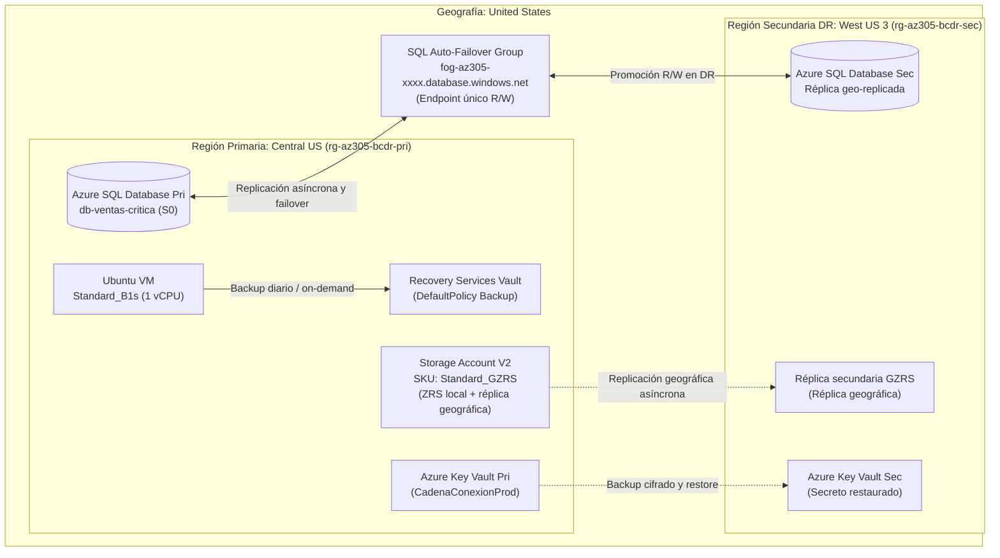

# Laboratorio 01: Arquitectura de Continuidad Empresarial y Recuperación ante Desastres (BCDR) en Azure

## 1. Caso de Negocio y Objetivo Arquitectónico

Diseñar e implementar una arquitectura resiliente multi-región dentro de la **Geografía de Estados Unidos** (`centralus` como región primaria y `westus3` como región secundaria de DR) capaz de garantizar objetivos bajos de **RPO/RTO** para datos transaccionales, protección frente a fallos zonales y regionales para el almacenamiento no estructurado, respaldo automatizado de cargas IaaS y recuperación interregional de secretos criptográficos, operando bajo restricciones estrictas de cuota (4 vCPU por región) y gobernanza FinOps.

---

## 2. Diagrama de Arquitectura

> **Nota:** GZRS combina almacenamiento redundante entre zonas en la región primaria con una réplica geográfica asíncrona en la región secundaria. El SQL Auto-Failover Group utiliza una réplica secundaria asincrónica y proporciona conmutación administrada mediante un endpoint único de lectura/escritura.

---

## 3. Decisiones de Arquitectura (ADR — Criterios Examen AZ-305)

| Componente | Tecnología Seleccionada | Alternativa Descartada | Justificación Técnica (AZ-305) |
| :--- | :--- | :--- | :--- |
| **Base de Datos Relacional PaaS** | **Azure SQL Database Auto-Failover Group** | Active Geo-Replication / Zone Redundancy | *Active Geo-Replication* permite réplicas administradas y conmutación, pero requiere mayor coordinación manual. *Zone Redundancy* protege dentro de una región y no ofrece DR entre regiones. El Auto-Failover Group gestiona automáticamente la conmutación de las bases incluidas mediante un endpoint R/W único. |
| **Almacenamiento de Objetos** | **Standard GZRS** | LRS / ZRS / GRS | GZRS combina la protección síncrona entre zonas de disponibilidad en la región primaria con una réplica asíncrona en una región secundaria emparejada. Es más resiliente que LRS/ZRS y mantiene menor costo y latencia que otras opciones con mayor separación geográfica. |
| **Protección de Cargas IaaS** | **Azure Backup (Recovery Services Vault)** | Snapshots manuales no gestionados | Automatiza copias, retención y recuperación de la VM. La protección de Azure Backup es independiente de las copias de seguridad específicas de SQL Server; si SQL se ejecuta en la VM, ambos mecanismos pueden ser necesarios. |
| **Gestión de Secretos DR** | **Key Vault Backup & Restore** | Replicación manual en texto plano | Los respaldos exportados están cifrados y pueden restaurarse dentro de los requisitos geográficos y de suscripción definidos por Azure. No se considera una conmutación automática: permite la recuperación controlada de claves y secretos en el entorno DR. |

## 4. Objetivos de Recuperación

Antes de la puesta en producción se deben validar y documentar los objetivos reales mediante pruebas de conmutación:

- **Azure SQL Database:** RPO y RTO según la replicación asíncrona y la configuración del Auto-Failover Group.
- **Storage GZRS:** protección regional y zonal con replicación secundaria asíncrona.
- **Azure Backup:** RPO condicionado por la planificación de respaldo y RTO por el tamaño y restauración de la VM.
- **Key Vault:** disponibilidad regional y recuperación mediante backup/restore, sin conmutación automática garantizada.
