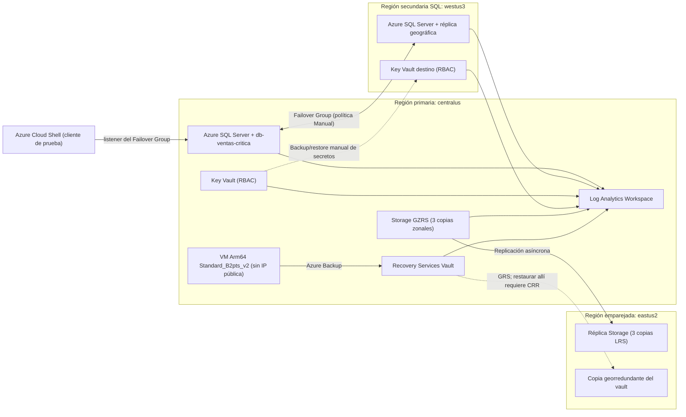

# Laboratorio 01: Continuidad Empresarial y Recuperación ante Desastres (BCDR)

> **Estado:** En revisión. Falta una corrida completa con los scripts actuales y su evidencia.
> **Enfoque AZ-305:** continuidad del negocio, almacenamiento de datos y monitoreo.

## Arquitectura



### Alcance real del DR

| Componente | ¿Recuperable si cae `centralus`? | Cómo |
| :--- | :--- | :--- |
| Azure SQL | Sí, en `westus3` | Failover del grupo (manual) |
| Storage | Sí, en `eastus2` | Failover de la cuenta (no probado). Sin RA-GZRS no hay lectura secundaria previa |
| Key Vault | Solo los secretos copiados | Copia puntual en `westus3`; repetir tras cada rotación |
| VM | **No en `westus3`** | Con `ENABLE_CRR=true`, restauración en `eastus2`. Para otra región, Azure Site Recovery (no admite Arm64; ver [Lab 01B](../01b-bcdr-asr-azure-backup)) |

## Decisiones de arquitectura (ADR)

| Decisión | Elección | Alternativas | Motivo |
| :--- | :--- | :--- | :--- |
| Redundancia de Storage | `Standard_GZRS` | LRS, ZRS, RA-GZRS | Redundancia zonal en la primaria y copia regional. RA-GZRS agrega lectura secundaria a mayor costo |
| Failover de SQL | Failover Group con política `Manual` (*customer managed*) | Política `Automatic` (*Microsoft managed*) | Microsoft recomienda `Manual`: tú decides cuándo conmutar |
| Resiliencia zonal de SQL | No incluida (`S0`) | Zone redundancy en un nivel que la admita | Es complementaria: cubre fallas de zona, no de región |
| Protección de VM | Azure Backup | Azure Site Recovery | Backup recupera datos desde puntos en el tiempo; Site Recovery replica la VM para conmutar con menor RPO/RTO |
| Acceso a la VM | Sin IP pública ni reglas de entrada | IP pública con SSH 22 | Reduce la superficie de ataque. Administración con Run Command |
| Autenticación SQL | Microsoft Entra ID (solo Entra en servidores nuevos) | Usuario y contraseña | Sin contraseñas que custodiar |
| Autorización Key Vault | Azure RBAC | Access policies | Modelo unificado y rol mínimo (*Secrets Officer*) |

## RPO / RTO

Los objetivos son propuestas para el lab; ajústalos a tu escenario.

| Componente | RPO objetivo | RTO objetivo | Medido | Fuente |
| :--- | :--- | :--- | :--- | :--- |
| SQL, failover planificado | 0 | < 1 min | Pendiente | `evidence/01-sql-failover-status.txt` |
| SQL, failover forzado | ~5 s | < 1 min | No se prueba | n/a |
| Storage GZRS | A definir | A definir | No se prueba | n/a |
| VM (Azure Backup) | 24 h (política diaria) | A definir | Pendiente | `evidence/07-vm-restore-disks.txt` (solo discos) |

El RTO observado incluye el intervalo de sondeo (~2 s más el tiempo de conexión).

## Ejecución en Azure Cloud Shell (Bash)

**Prerrequisitos**
- Rol que permita crear recursos y asignar roles (por ejemplo, Owner de la suscripción).
- Usa una sesión con almacenamiento montado si quieres conservar archivos y evidencias.
- Si un comando falla por token o audiencia: `az login --use-device-code`.

```bash
cd 01-bcdr-sql-backup-keyvault
./scripts/01-deploy.sh                 # reejecutable
./scripts/02-test-workloads.sh         # todas las pruebas, salvo restore
./scripts/02-test-workloads.sh restore # cuando el backup esté "Completed"
./scripts/03-cleanup.sh                # pide escribir BORRAR
```

> Cloud Shell cierra la sesión tras 20 minutos sin interacción. Si ocurre, vuelve a ejecutar el mismo comando.
> Para un respaldo en curso usa `./scripts/02-test-workloads.sh backup-status`.

| Variable | Uso |
| :--- | :--- |
| `SUFFIX` | Fuerza el sufijo de un despliegue |
| `ENABLE_NAT=true` | Agrega NAT Gateway si la VM necesita salida (genera costo) |
| `ENABLE_CRR=true` | Habilita Cross Region Restore en el vault |
| `VM_SIZE`, `VM_IMAGE` | Cambian la VM; deben coincidir en arquitectura |
| `SKIP_PROBE=true` | Failover sin cliente SQL (no mide RTO/RPO) |

## Evidencias

| Archivo | Contenido | Estado |
| :--- | :--- | :--- |
| `01-sql-failover-status.txt` | Failover, failback, RTO/RPO observados | Regenerar |
| `02-storage-gzrs-status.txt` | Regiones y SKU | Disponible |
| `03-backup-job-completed.txt` | Solo se escribe si el trabajo termina | Regenerar (la versión anterior dice `InProgress`) |
| `04-kv-secret-restored.txt` | Secreto en el vault secundario | Disponible |
| `05-sql-metrics.txt` | Métricas de ambos servidores | Pendiente |
| `06d-sql-failover-activity-log.txt` | Operaciones de failover | Regenerar |
| `07-vm-restore-disks.txt` | Restauración de discos | Pendiente |

Los scripts ocultan GUIDs, correos e IPv4. Revisa igualmente cada archivo antes de publicarlo.

## Costos y limpieza

- Generan consumo: la base `S0` y su réplica, Storage GZRS, la VM y su disco, Azure Backup, Log Analytics y, si lo activas, NAT Gateway.
- `03-cleanup.sh` solo informa éxito cuando comprueba que los grupos no existen, y purga los Key Vault del lab.
- El *soft delete* de Azure Backup puede retener el vault y su grupo. En ese caso el script elimina los demás recursos, informa limpieza incompleta y debes repetirlo al vencer la retención.

## Limitaciones

- No se prueba failover forzado, failover de Storage ni recuperación completa de una VM.
- Los Key Vault no tienen *purge protection* para permitir limpiar el lab; en producción debe activarse.
- SQL y Key Vault usan acceso público (SQL restringido por firewall). En producción evaluar Private Endpoints.
