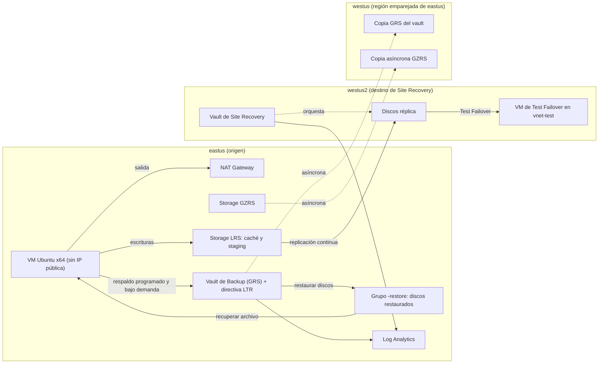

# Laboratorio 01B: Recuperación ante desastres de IaaS con Site Recovery y Azure Backup

> **Estado:** En validación. Los scripts pasan ShellCheck y pruebas contra un Azure simulado; falta la corrida real y su evidencia.
> **Dominio AZ-305:** diseño de soluciones de continuidad del negocio.

## Escenario

Una aplicación corre en una VM en `eastus` y debe responder a dos riesgos distintos:

| Riesgo | Control | Qué demuestra el lab |
| :--- | :--- | :--- |
| Caída de la región | Azure Site Recovery hacia `westus2` | Test Failover en una red aislada, sin afectar el origen |
| Borrado o corrupción de datos | Azure Backup con retención a largo plazo | Borrado simulado y recuperación del archivo desde un punto anterior |

## Habilidades demostradas

- Diseño de DR entre regiones: fabrics, contenedores, directiva de replicación, mapeos y red de pruebas aislada.
- Directiva de respaldo LTR (diaria, semanal, mensual y anual) generada como código.
- Selección de redundancia de almacenamiento (LRS, ZRS, GRS, GZRS y variantes con lectura).
- Automatización idempotente con Azure CLI y API REST, evidencia sanitizada y limpieza verificada.

## Arquitectura



## Site Recovery frente a Azure Backup

| Criterio | Site Recovery | Azure Backup |
| :--- | :--- | :--- |
| Objetivo | Continuidad: levantar la VM en otra región | Recuperación de datos de un momento anterior |
| Frecuencia | Replicación continua | Según la directiva (aquí, diaria) |
| Historial en este lab | Puntos de recuperación de 24 h | 30 días, 12 semanas, 12 meses y 3 años |
| Borrado accidental | Se replica al destino; solo sirve un punto anterior dentro de la ventana | Se recupera desde un punto retenido |
| Dónde vive el vault | Región distinta a la VM | Misma región que la VM |

## Redundancia de Azure Storage

| SKU | Región primaria | Región secundaria | Cubre caída de zona | Cubre caída de región | Lectura en la secundaria |
| :--- | :--- | :--- | :---: | :---: | :---: |
| LRS | Copias síncronas en un centro de datos | No | No | No | No |
| ZRS | Copias síncronas en 3 o más zonas | No | Sí | No | No |
| GRS | LRS (síncrona) | Copia asíncrona (LRS) | Con failover | Sí, con failover | No |
| RA-GRS | LRS (síncrona) | Copia asíncrona (LRS) | Lectura | Sí | Sí |
| GZRS | ZRS (síncrona) | Copia asíncrona (LRS) | Sí | Sí, con failover | No |
| RA-GZRS | ZRS (síncrona) | Copia asíncrona (LRS) | Sí | Sí | Sí |

La replicación geográfica es asíncrona: si la región primaria se pierde, puede perderse lo último escrito. Fuente: [redundancia de Azure Storage](https://learn.microsoft.com/azure/storage/common/storage-redundancy).

## Decisiones de arquitectura (ADR)

| Decisión | Elección | Motivo |
| :--- | :--- | :--- |
| Tamaño de VM | `Standard_B2ats_v2` (x64, 2 vCPU) | Site Recovery exige al menos 2 vCPU y no admite Arm64, por lo que `B1s` no sirve ([matriz de soporte](https://learn.microsoft.com/en-us/azure/site-recovery/azure-to-azure-support-matrix)) |
| Dos vaults | Backup en `eastus`, Site Recovery en `westus2` | Backup protege VMs de su región; Site Recovery requiere un vault fuera de la región de origen |
| Redundancia del vault | GRS | El vault admite LRS, ZRS o GRS; no ofrece GZRS |
| GZRS | Storage Account separada | Azure Backup de VM guarda los datos en el vault; la cuenta demuestra GZRS y conserva una copia de la directiva |
| Destino de DR | `westus2` | No es la pareja de `eastus` (es `westus`): las copias GRS van a `westus` y Site Recovery replica a donde tú eliges |
| Salida a Internet | NAT Gateway, sin IP pública | Site Recovery necesita salida; no se abre ningún puerto de entrada |
| Red de pruebas | Sin peering; salida solo HTTPS hacia Azure | Aísla la VM de prueba y permite verificarla con Run Command, que [requiere salida](https://learn.microsoft.com/azure/virtual-machines/linux/run-command) |
| Failback y reprotección | Fuera de alcance | El Test Failover valida la recuperación sin interrumpir el origen |

## Ejecución en Azure Cloud Shell (Bash)

**Prerrequisitos**

- Rol para crear recursos y asignar roles (por ejemplo, Owner de la suscripción).
- 2 vCPU libres en `eastus` y 2 en `westus2` (el script lo comprueba).
- Azure CLI actualizado; el script instala la extensión `site-recovery`.

```bash
cd 01b-bcdr-asr-azure-backup
./scripts/01-deploy.sh                       # reejecutable
./scripts/02-test.sh backup --no-wait        # el respaldo corre en paralelo
./scripts/02-test.sh status                  # repetir hasta que permita Test Failover
./scripts/02-test.sh test-failover
./scripts/02-test.sh failover-cleanup
./scripts/02-test.sh backup-status           # repetir hasta "Completed"
./scripts/02-test.sh simulate-delete         # borra el archivo marcador
./scripts/02-test.sh restore
./scripts/02-test.sh recover-file
./scripts/02-test.sh redundancy
./scripts/03-cleanup.sh                      # pide escribir BORRAR
```

> La replicación inicial y los respaldos tardan. Cloud Shell se cierra tras 20 minutos sin interacción: vuelve a ejecutar el mismo subcomando y continúa.

| Variable (antes del primer despliegue) | Valor por defecto | Uso |
| :--- | :--- | :--- |
| `VM_SIZE` | `Standard_B2ats_v2` | x64 con 2 vCPU o más |
| `VM_IMAGE` | Ubuntu 22.04 Gen2 | Debe tener kernel compatible con Site Recovery |
| `STG_SKU` | `Standard_GZRS` | Usa `Standard_RAGZRS` para ver `lastSyncTime` |
| `VAULT_REDUNDANCY` | `GeoRedundant` | Redundancia del vault de Backup |
| `ENABLE_CRR` | `false` | Cross Region Restore (no se puede desactivar y agrega costo) |
| `LTR_DAILY`, `LTR_WEEKLY`, `LTR_MONTHLY`, `LTR_YEARLY` | 30, 12, 12, 3 | Retención |
| `RG_PREFIX` | `rg-az305-1b` | Prefijo de los grupos de recursos |

## Resultados y evidencia

| Archivo en `evidence/` | Qué prueba | Estado |
| :--- | :--- | :--- |
| `01-asr-replication.txt` | Replicación lista, salud y RPO | Pendiente |
| `02-test-failover.txt` | VM de prueba aislada con los datos; RPO y duración | Pendiente |
| `03-test-failover-cleanup.txt` | Limpieza sin afectar la replicación | Pendiente |
| `04-backup-job.txt` | Respaldo completado y puntos de recuperación | Pendiente |
| `05-simulated-deletion.txt` | Borrado accidental simulado | Pendiente |
| `06-restore-job.txt` | Restauración de discos | Pendiente |
| `07-file-recovery.txt` | Archivo recuperado | Pendiente |
| `08-redundancy-ltr.txt` | Redundancia y retención configuradas | Pendiente |

| Métrica | Objetivo del lab | Medido |
| :--- | :--- | :--- |
| RPO de Site Recovery | ≤ 15 min | Pendiente |
| Duración del Test Failover | ≤ 30 min | Pendiente |
| RPO de Azure Backup | 24 h (directiva diaria) | Por diseño |

La retención semanal, mensual y anual queda configurada; los puntos correspondientes solo se generan con el paso del tiempo.

Consultas KQL: [`queries/bcdr-iaas.kql`](./queries/bcdr-iaas.kql).

## Costos y limpieza

- Generan consumo: VM y discos, instancia protegida y réplica de Site Recovery, Azure Backup e instantáneas, dos NAT Gateway con sus IP públicas, dos Storage Accounts y Log Analytics. Ejecuta la limpieza el mismo día.
- `03-cleanup.sh` desmonta Site Recovery en orden, detiene la protección, borra los puntos de restauración y los grupos, y solo informa éxito si lo verifica. `--verify` repite la comprobación.
- Azure Backup aplica [*soft delete*](https://learn.microsoft.com/en-us/azure/backup/secure-by-default): los datos borrados se conservan un periodo. Si impide borrar el vault, el script elimina el resto, informa limpieza incompleta y debes repetirlo después.

## Solución de problemas

| Síntoma | Acción |
| :--- | :--- |
| SKU o cuota no disponible | Exporta otro `VM_SIZE` o libera vCPU |
| La replicación falla por kernel no compatible | Limpia y despliega con una versión anterior en `VM_IMAGE` |
| La replicación no avanza | `az site-recovery job list -g rg-az305-1b-dr --vault-name <vault> -o table` |
| No se verifica el marcador en la VM de prueba | Revisa el agente de la VM en el portal antes de limpiar el Test Failover |
| El disco restaurado queda conectado | `az vm disk detach` antes de reiniciar la VM |

## Limitaciones

- Solo Test Failover: no se prueba failover real, reprotección ni failback.
- Una VM sin discos de datos y sin Recovery Plans.
- La red de pruebas permite HTTPS saliente hacia direcciones de Azure.
