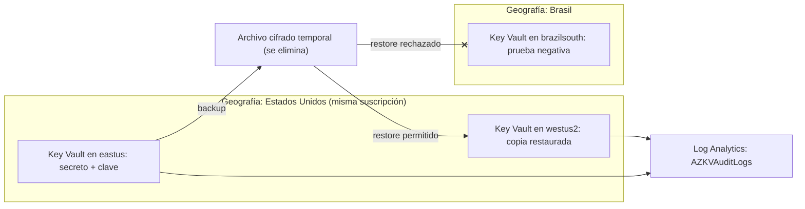

# Laboratorio 01C: Respaldo y recuperación de secretos y claves en Azure Key Vault

> **Estado:** Completado. Ejecutado en Azure desde Cloud Shell el 2026-11-27, con evidencia.
> **Dominio AZ-305:** continuidad del negocio y seguridad de secretos.

## Escenario

Un equipo necesita una copia independiente de un secreto y una clave en otra región y debe saber **dónde sí y dónde no** puede restaurarlos.

| Prueba | Resultado esperado |
| :--- | :--- |
| Restaurar de `eastus` a `westus2` | Funciona: misma suscripción y geografía |
| Valor y clave restaurados | Mismo SHA-256; lo cifrado en origen se descifra en destino |
| Cambiar el secreto en origen | El destino no cambia: no es replicación |
| Restaurar en `brazilsouth` | Azure lo rechaza: otra geografía |

## Habilidades demostradas

- Key Vault Standard con Azure RBAC y roles de datos específicos (*Secrets Officer* y *Crypto Officer*).
- Respaldo y restauración con todas las versiones, verificada sin mostrar el secreto.
- Pruebas negativas con un control que descarta fallos por permisos.
- Auditoría en Log Analytics y limpieza con purga verificada.

## Arquitectura



## Reglas de respaldo y restauración

| Regla | Detalle |
| :--- | :--- |
| Destino | Un vault de la **misma suscripción** y la **misma geografía** de Azure |
| Formato | Blob cifrado que no puede descifrarse fuera de Azure |
| Alcance | Por objeto (no existe respaldo del vault completo en Standard) |
| Versiones | Hasta 500 por objeto |
| Vigencia | Copia de un momento: no se actualiza al rotar |
| Nombre | El destino no debe tener un objeto con ese nombre, activo o en *soft delete* |

Fuente: [confiabilidad de Azure Key Vault](https://learn.microsoft.com/azure/reliability/reliability-key-vault).

## Decisiones de arquitectura (ADR)

| Decisión | Elección | Motivo |
| :--- | :--- | :--- |
| Estrategia | Backup y restore como copia independiente | La replicación administrada hacia la región emparejada la controla Microsoft y, tras un failover, el vault queda en solo lectura |
| Segunda región | `westus2` | Está en la misma geografía que `eastus`; no es su región emparejada, así que agrega una copia en un lugar distinto |
| Nivel | Standard | Claves RSA protegidas por software; Premium agrega claves protegidas por HSM |
| Autorización | Azure RBAC | Rol por tipo de dato y alcance por vault |
| Archivos de respaldo | Temporales, permisos restringidos, borrado automático | Reducen la exposición |
| Purge protection | Desactivada | Permite limpiar y repetir el lab; en producción debe activarse |

## Ejecución en Azure Cloud Shell (Bash)

**Prerrequisitos:** rol para crear recursos, asignar roles y purgar Key Vault (por ejemplo, Owner de la suscripción).

```bash
cd 01c-keyvault-backup-restore
./scripts/01-deploy.sh          # reejecutable
./scripts/02-test.sh all        # o por pasos: backup-restore, verify, independence, cross-geo
./scripts/03-cleanup.sh         # pide escribir BORRAR y purga los vaults
```

La asignación de roles puede tardar en propagarse; los scripts reintentan.

| Subcomando adicional | Uso |
| :--- | :--- |
| `./scripts/02-test.sh reset-dr` | Borra y purga los objetos restaurados para repetir la restauración |

| Variable (antes del primer despliegue) | Valor por defecto |
| :--- | :--- |
| `LOC_PRI` | `eastus` |
| `LOC_DR` | `westus2` (misma geografía que `LOC_PRI`) |
| `LOC_FOREIGN` | `brazilsouth` (otra geografía) |
| `RG_PREFIX` | `rg-az305-1c` |

## Resultados y evidencia

Salidas reales en [`evidence/EVIDENCIA-CONSOLIDADA.md`](./evidence/EVIDENCIA-CONSOLIDADA.md), un bloque por prueba.

| Bloque | Qué prueba | Resultado |
| :--- | :--- | :--- |
| `01-backup-restore.txt` | Respaldo y restauración entre regiones | `eastus` → `westus2`: secreto y clave con 2 versiones cada uno |
| `02-verification.txt` | Versiones, SHA-256 y descifrado | Mismo SHA-256; lo cifrado en origen se descifra en destino |
| `03-independence.txt` | La copia no se sincroniza | 3 versiones en origen, 2 en destino |
| `04-cross-geography.txt` | Rechazo entre geografías | Rechazado en `brazilsouth`; el secreto no quedó en el destino |

**Cómo leer el rechazo:** Azure responde `Cannot decrypt backup blob`, un mensaje que no menciona la geografía. La conclusión se apoya en la regla documentada y en el control previo: una escritura en el vault de destino funcionó, lo que descarta un problema de permisos de escritura.

Consultas KQL: [`queries/keyvault-audit.kql`](./queries/keyvault-audit.kql).

## Costos y limpieza

- Consumo bajo: operaciones de Key Vault e ingestión en Log Analytics.
- La limpieza elimina y **purga** los vaults, borra el workspace y los grupos, y solo informa éxito si lo verifica.

## Limitaciones

- La restricción de **suscripción** se documenta pero no se prueba (requiere una segunda suscripción).
- No se prueban certificados, claves en HSM ni Managed HSM.
- Los vaults usan acceso público; en producción evaluar Private Endpoints y firewall.
